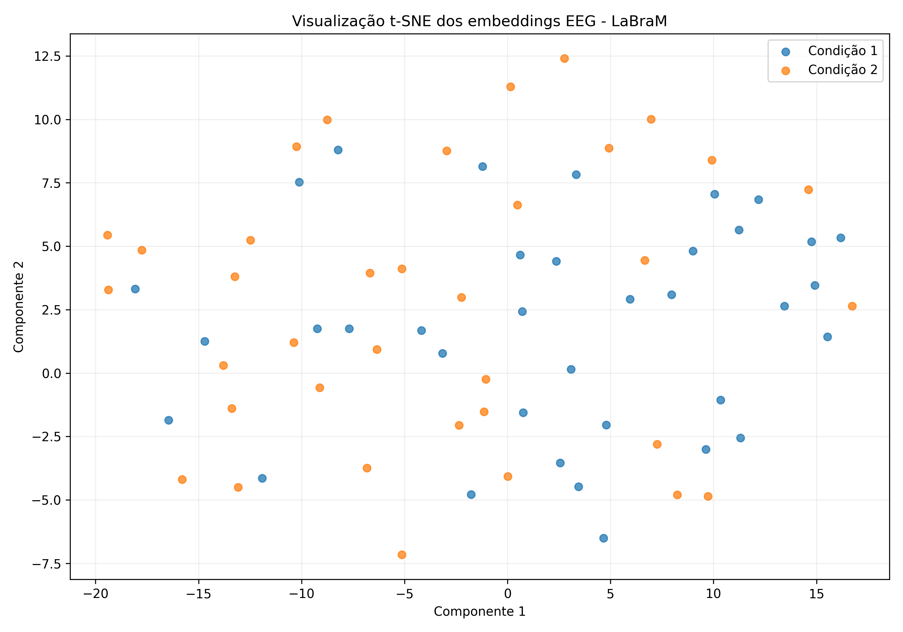

# Aula 05 – Embeddings, Busca Vetorial e Modelos Multimodais

## 1. Identificação do projeto

**Projeto:** EEGMAT – EEG During Mental Arithmetic Tasks  
**Fonte dos dados:** PhysioNet  
**Modelo utilizado:** LaBraM (Large Brain Model)  
**Checkpoint:** `braindecode/labram-pretrained`  
**Data de elaboração:** 03/11/2026

## 2. Objetivo

O objetivo desta etapa foi aplicar um modelo pré-treinado de representação
de sinais EEG para extrair embeddings das gravações do conjunto EEGMAT
e realizar buscas por similaridade entre essas representações.

A proposta foi explorar se gravações pertencentes às mesmas condições
experimentais apresentam representações vetoriais semelhantes.

## 3. Base de dados

Foi utilizado o conjunto EEGMAT, disponibilizado no PhysioNet.

O processamento contemplou:

- 36 participantes;
- 72 gravações;
- Duas condições experimentais identificadas como condição 1 e condição 2;
- 19 canais de EEG utilizados na extração;
- Frequência de amostragem original de 500 Hz.

As gravações foram identificadas pelo participante e pela condição
experimental. Os arquivos foram mantidos separados durante a extração
dos embeddings.

Fonte: https://physionet.org/content/eegmat/1.0.0/

## 4. Modelo pré-treinado

Foi utilizado o LaBraM (Large Brain Model), modelo desenvolvido para
aprender representações genéricas de sinais de eletroencefalografia.

**Checkpoint utilizado:** `braindecode/labram-pretrained`

Referência:

Jiang et al. (2024). *Large Brain Model for Learning Generic
Representations with Tremendous EEG Data in BCI*. ICLR 2024.

Repositório:
https://github.com/935963004/LaBraM

Checkpoint:
https://huggingface.co/braindecode/labram-pretrained

O modelo foi carregado por meio da biblioteca Braindecode e utilizado
em modo de avaliação, sem treinamento adicional.

A saída `cls_token` foi utilizada como representação vetorial de cada
janela, produzindo embeddings de 200 dimensões.

## 5. Pré-processamento dos sinais

Os arquivos EDF foram carregados utilizando a biblioteca MNE.

As etapas aplicadas foram:

1. Seleção dos 19 canais de EEG;
2. Padronização dos nomes dos canais para a nomenclatura utilizada
   pelo modelo;
3. Filtragem passa-faixa de 0,1 a 75 Hz;
4. Aplicação de filtro notch em 50 Hz;
5. Reamostragem de 500 Hz para 200 Hz;
6. Conversão da unidade do sinal e aplicação da escala utilizada
   no processamento;
7. Segmentação em janelas consecutivas de 15 segundos.

Cada janela completa continha 3.000 amostras por canal.
Janelas finais incompletas foram descartadas.

A escala aplicada ao sinal foi:

`(sinal em volts × 1.000.000) / 100`

## 6. Extração dos embeddings

O modelo LaBraM foi utilizado para extrair um vetor de características
de 200 dimensões para cada janela de 15 segundos.

Foram processadas:

- **Janelas:** 568
- **Gravações:** 72
- **Participantes:** 36

Os resultados individuais foram armazenados em
`embeddings_por_janela.csv`.

Posteriormente, foi calculada a média dos embeddings de todas as
janelas pertencentes a cada gravação, gerando o arquivo
`embeddings_por_gravacao.csv`.

Essa agregação permitiu utilizar uma representação vetorial única
para cada gravação nas etapas de busca por similaridade e visualização.

## 7. Busca vetorial por similaridade

Foi utilizada a similaridade de cosseno para comparar os embeddings
médios das gravações.

Para cada gravação, foram recuperados os três vizinhos mais próximos,
desconsiderando a própria gravação.

Resultados:

| Indicador | Resultado |
|---|---:|
| Pares de vizinhos analisados | 216 |
| Similaridade média de cosseno | 0.9892 |
| Vizinhos da mesma condição | 50.46% |
| Vizinhos do mesmo participante | 14.35% |

A similaridade média elevada indica proximidade entre os vetores
recuperados. Entretanto, esse valor não representa acurácia nem
demonstra, isoladamente, equivalência entre os sinais.

A proporção de vizinhos pertencentes à mesma condição foi de
50.46%, resultado que não indica uma preferência
expressiva pela recuperação de gravações da mesma condição.

## 8. Visualização dos embeddings

Foi aplicada a técnica t-SNE para reduzir os embeddings de 200
dimensões para duas dimensões, permitindo a visualização exploratória
da distribuição das gravações.

O gráfico foi gerado com as duas condições experimentais identificadas
por cores diferentes.

Na visualização, os pontos das duas condições aparecem distribuídos
de forma relativamente misturada, sem separação visual evidente.

Esse comportamento está de acordo com os resultados da busca vetorial,
que apresentou aproximadamente metade dos vizinhos pertencentes
à mesma condição.

A projeção t-SNE é exploratória e não deve ser interpretada como
uma medida de desempenho do modelo.

## 9. Discussão e limitações

A aplicação demonstrou que o modelo LaBraM pode ser utilizado para
extrair representações vetoriais de gravações EEG e realizar buscas
por similaridade.

Entretanto, algumas limitações precisam ser consideradas:

- O modelo pré-treinado possui configuração de referência para
  128 canais, enquanto foram utilizados 19 canais do EEGMAT.
- A seleção e o mapeamento dos canais podem influenciar as
  representações obtidas.
- O pré-processamento adotado pode diferir daquele utilizado
  originalmente no treinamento do modelo.
- A média dos embeddings das janelas pode reduzir variações
  temporais presentes nos sinais.
- As gravações possuem durações diferentes, resultando em
  quantidades distintas de janelas.
- As duas condições não apresentaram separação visual evidente
  na projeção t-SNE.
- Não foi treinado um classificador nem realizada validação
  supervisionada das condições.

Portanto, não é possível afirmar, com este experimento, que o
modelo distingue adequadamente as condições experimentais.
Os resultados devem ser interpretados como uma exploração
das representações e das relações de similaridade entre gravações.

## 10. Conclusão

A atividade permitiu aplicar um modelo pré-treinado específico
para sinais EEG na extração de embeddings, realizar busca vetorial
por similaridade e visualizar as representações em duas dimensões.

Foram obtidas representações de 200 dimensões para 568
janelas, referentes a 72 gravações de 36
participantes.

A busca pelos três vizinhos mais próximos apresentou similaridade
média de 0.9892. Entretanto, a proporção de
vizinhos da mesma condição foi de 50.46%,
e a visualização t-SNE não demonstrou agrupamentos claramente
separados.

Assim, a atividade atingiu o objetivo de aplicar embeddings
e busca vetorial ao conjunto EEGMAT, permitindo explorar
as representações aprendidas pelo modelo e identificar
limitações para a distinção das condições experimentais.

## 11. Arquivos gerados

- `embeddings_por_janela.csv`: embeddings individuais das janelas,
  com identificação das amostras e participantes.
- `embeddings_por_gravacao.csv`: embeddings médios por gravação.
- `vizinhos_mais_proximos.csv`: três vizinhos mais próximos
  de cada gravação.
- `visualizacao_tsne_eegmat.png`: projeção bidimensional dos embeddings.
- `checkpoints/`: resultados intermediários da extração.

## 12. Reprodutibilidade

O processamento foi realizado em ambiente Python no Google Colab.

Versões registradas:

- Python: conferir no ambiente de execução do Colab;
- Braindecode: 1.4.0;
- PyTorch: 2.11.0+cpu.

O modelo foi obtido pelo Hugging Face Hub e os dados foram
obtidos no PhysioNet.

Para reproduzir o experimento, é necessário disponibilizar
os arquivos EDF do conjunto EEGMAT, instalar as dependências
e executar as etapas de pré-processamento, extração dos
embeddings, agregação, busca vetorial e visualização.
